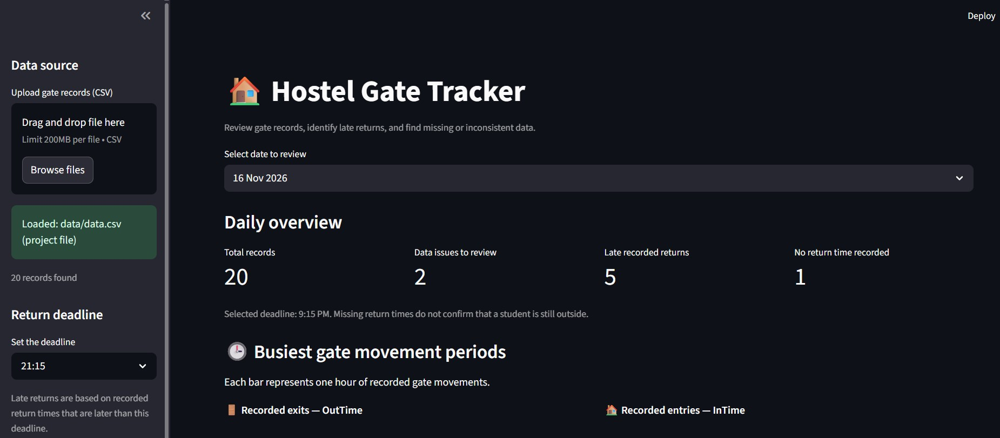
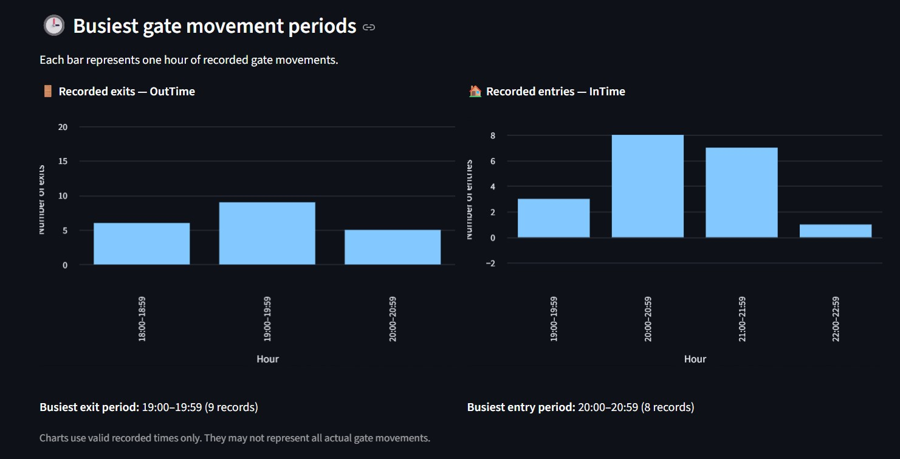
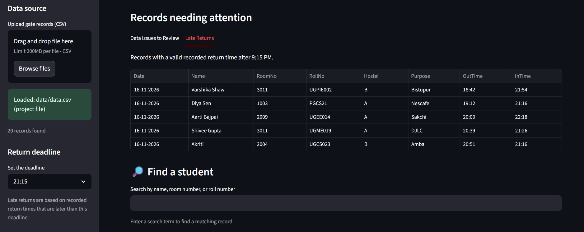

# Hostel Gate Tracker

A simple Streamlit application that helps hostel security staff review gate records, identify late recorded returns, find incomplete or potentially inconsistent data, and understand busy entry and exit periods.

## Problem

The hostel relies on a manual register to record student entry and exit movements. Reviewing these records can be time-consuming, especially when checking return times against the hostel deadline or identifying missing entries.

Hostel Gate Tracker provides a simple way to review these records digitally using a CSV file.

## Features

- **CSV upload:** Upload a CSV file through the sidebar or use the project's default `data/data.csv`.
- **Configurable return deadline:** Set a deadline according to the hostel's requirements instead of relying on a fixed time.
- **Daily overview:** View the total number of records, data issues, late recorded returns, and records without a recorded return time.
- **Data Issues to Review:** Identify missing essential information, invalid date or time formats, and potentially inconsistent exit and return times. Each flagged record includes a reason for review.
- **Busiest entry and exit periods:** View hourly charts showing when exits and returns were most frequently recorded for the selected date.
- **Late returns:** Review records with valid return times later than the configured deadline.
- **Student search:** Search records by name, room number, or roll number.
- **Privacy-conscious display:** Mobile numbers are excluded from the displayed record tables.

## Application Screenshots

### 1. Daily Overview

The dashboard provides a summary of the selected day's gate records, including total records, data issues, late recorded returns, and missing return times. It helps the guard quickly identify which records may need attention.



### 2. Busiest Entry and Exit Periods

The hourly bar charts show the distribution of recorded exit and return times. The application also identifies the busiest recorded hour for entries and exits, helping the guard understand when gate movements are most frequent.



### 3. Late Returns and Configurable Deadline

The guard can set a return deadline using the sidebar. The application lists records with valid return times later than that deadline, making it easier to review potentially late returns without manually scanning every entry.



## How to Run

### 1. Clone the repository

```bash
git clone https://github.com/Anwesha4/hostel-gate-tracker.git
cd hostel-gate-tracker
```

### 2. Install dependencies

It is recommended to create a virtual environment.

```bash
python -m venv .venv
```

On Windows PowerShell:

```powershell
.\.venv\Scripts\Activate.ps1
```

Install the required packages:

```bash
pip install -r requirements.txt
```

### 3. Prepare the CSV file

The application can use the default file at `data/data.csv`, or the user can upload a CSV through the sidebar.

The CSV must contain the following columns:

`Date, Name, RoomNo, RollNo, Hostel, Purpose, MobileNo, OutTime, InTime`

Ensure the column names match the expected format.

### 4. Run the application

```bash
python -m streamlit run app.py
```

Open the local URL displayed in the terminal, usually `http://localhost:8501`.

## How to Use the Application

1. **Choose the data source:** Use `data/data.csv` or upload another CSV through the sidebar.
2. **Set the return deadline:** Choose the time appropriate for the hostel.
3. **Select a date:** Review the records for the chosen date.
4. **Review the dashboard:** Check the daily overview and hourly movement charts.
5. **Inspect data issues:** Open *Data Issues to Review* to find missing information, invalid formats, or potentially inconsistent times.
6. **Check late returns:** Open *Late Returns* to review recorded returns after the configured deadline.
7. **Find a student:** Search by name, room number, or roll number to locate matching records.

## Limitations

1. **Overnight return ambiguity:** If a student leaves at 9 PM and returns at 1 AM the following day, the application may flag the times as potentially inconsistent. Because the CSV has only one date field, it cannot reliably determine whether the return occurred the next day.
2. **No verification of recorded details:** The application cannot confirm whether student details or recorded movements are genuine and accurate. It identifies certain data issues but cannot independently verify them.
3. **Unrecorded movements remain undetected:** If a student enters or exits without the movement being recorded, the application cannot detect that event from the CSV alone.
4. **Missing return times are ambiguous:** A blank return time does not establish that a student is still outside. The return may not have been recorded or the record may not have been updated.
5. **Late-return classification has no exception handling:** The application compares valid recorded return times with the configured deadline but does not account for approved late passes or special permissions.

## Technology Stack

- Python
- Streamlit
- Pandas

## Conclusion

Hostel Gate Tracker is a lightweight record-review aid intended to reduce the effort required to inspect hostel gate records. It highlights records that may need attention and summarizes recorded movement patterns, while leaving verification and final decisions to the responsible hostel staff.

It supports the existing record-review process but does not replace the official register or independently verify student whereabouts.


## Demo Video

Watch the 3-minute demonstration of the Hostel Gate Tracker:

[Watch the demo video] (https://drive.google.com/file/d/1Z08hH4UqCwH3yv8T7mNHCZrGHcp7AXy3/view?usp=sharing)