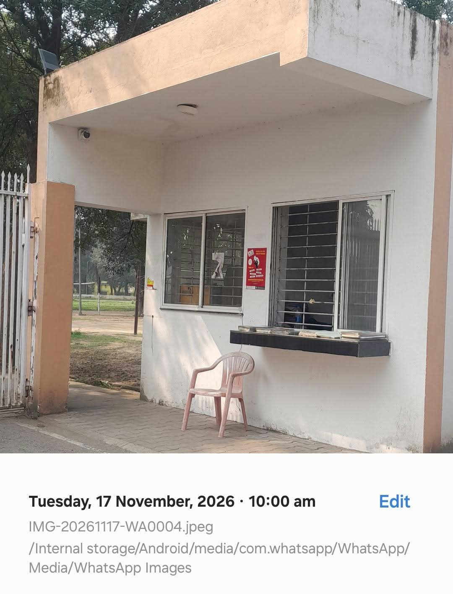
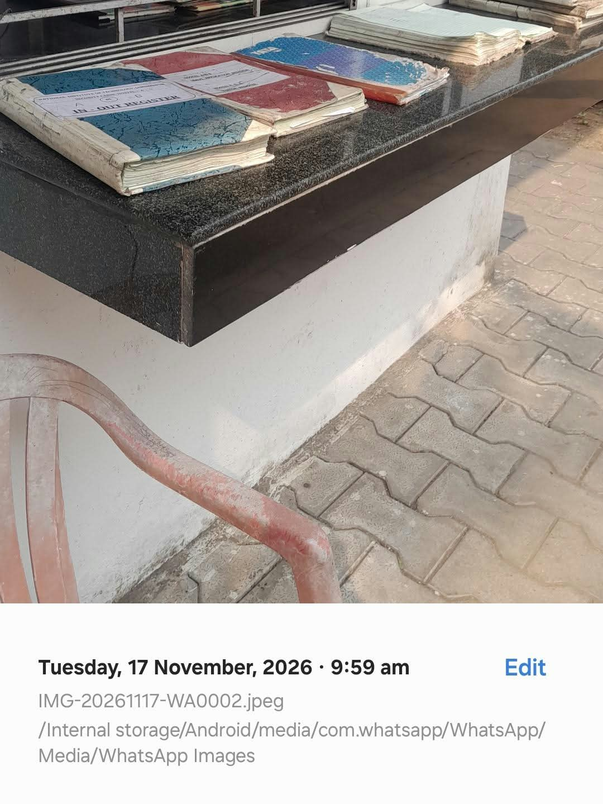

# Fieldwork Documentation

## 1. Fieldwork Details

- **Participant:** Babita Kumari
- **Role:** Security Guard posted at Hostel A/B
- **Location:** Hostel A/B, NIT Jamshedpur, Jharkhand, India
- **Date:** 17 November 2026
- **Time:** 9:42 AM
- **Duration:** Approximately 20 minutes

## 2. Photographic Evidence

### Photo 1: Security Guard Office

*Location: Hostel A/B, NIT Jamshedpur | Date: 17 November 2026 |*

This photograph documents the security guard's workplace, where the existing hostel gate-entry record-keeping process is managed.

### Photo 2: Closed Register

*Location: Hostel A/B, NIT Jamshedpur | Date: 17 November 2026 |*

The register was photographed closed to protect the privacy of the individuals whose information it contains. The participant also preferred not to have her face photographed due to concerns about potential risks, and her preference was respected.

## 3. Conversation with the Participant

I spoke with Babita Kumari to understand the difficulties she faces while maintaining and monitoring hostel entry and exit records.

The three main problems she described were:

1. **Difficulty maintaining accurate records:** Managing entries for a large number of students is challenging. Records can contain typographical errors, inconsistencies, or incorrect entry and exit times, whether intentional or accidental.

2. **Time-consuming tracking after deadlines:** At the end of the day, she has to manually search through numerous records to identify students who have not returned by the prescribed deadline and determine whom to contact. This makes the process slow and difficult.

3. **Missed entries and identity inconsistencies:** Some students skip the recording process, particularly when leaving in groups. In some cases, students may also provide inaccurate identity information, making record verification more difficult.

### One Thing That Surprised Me

I was surprised by how hesitant the participant was initially. She was reluctant to share her name or discuss the problems she faced. She became more comfortable speaking only after I explained that this was a college project.

I had assumed that collecting information would be relatively easy because the security staff are familiar to us as students. However, I had to obtain permission from my supervisor before collecting the data and respect the restriction against photographing the register. Consequently, I manually noted down the records instead. This experience taught me the importance of obtaining permission, building trust, and respecting privacy during fieldwork.

## 4. Raw Data and Collection Method

The collected records are available in [data.csv](data/data.csv).

**Privacy note:** Signatures and actual phone numbers have been omitted from the publicly shared dataset to protect students' personal information.

I manually noted down approximately 20 genuine records from the previous day's register, with permission from the participant. I was not permitted to photograph the register's contents, so the records were transcribed manually rather than extracted from photographs.

The data will be used to understand the existing record structure and demonstrate the proposed Hostel Gate Tracker. Identifying details, such as IDs and phone numbers, will be altered or anonymised before the data is published in the public repository.

The dataset represents a small sample of records collected during the fieldwork and is not intended to represent all hostel-entry activity.

**Privacy Note:** Signatures and actual phone numbers have been omitted from the publicly shared dataset to protect students' personal information. Student identifiers have also been anonymised where necessary. The records are based on genuine data collected during fieldwork, with sensitive information excluded or modified for privacy.